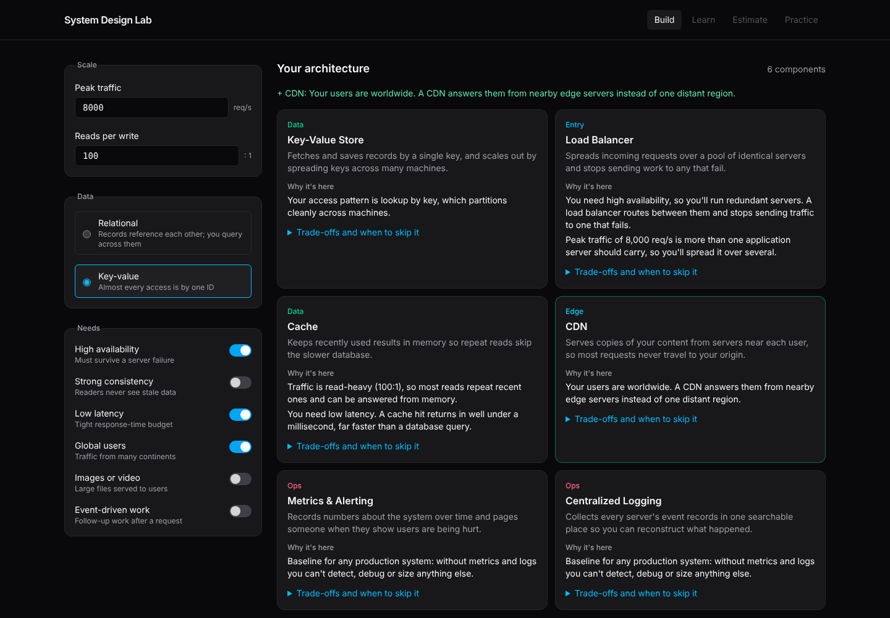

<h1 align="center">System Design Lab</h1>

<p align="center">
  <a href="https://github.com/arndvs/system-design-lab/actions/workflows/ci.yml"></a>
  <a href="LICENSE"></a>
  <br>
  Set your requirements and see the architecture they call for, with the reason behind every component, what it will cost you, and when you'd be better off without it.
</p>

<p align="center">
  <a href="https://arndvs.github.io/system-design-lab/"><strong>Open the live site →</strong></a>
</p>



---

## Why this exists

A table that maps problems to components is good for review. It's less good at teaching what interviews and real projects test: why a piece belongs in this design, what new problem it creates, and when it's overkill.

System Design Lab makes those links visible. Change one requirement and you see exactly what gets added or dropped, and the reason.

## What's in it

| Section | Status | What you do there |
|---|---|---|
| **Build** | Live | Describe the **features** and data shape, then set **quality targets** (availability, response time and consistency as real targets). You get the components, where they should run, and the trade-offs your requirements force. Every component is tagged with which side of the requirements pulled it in. Your settings live in the URL, so you can share a design. |
| **Evolve** | Engine done | Replay a design from a single server, one bottleneck at a time. |
| **Estimate** | Engine done | Throughput and storage calculators that show every step of the math with your numbers. |
| **Learn** | Planned | Browse every component by layer, with glossary and sourced latency figures. |
| **Practice** | Planned | Work through scenarios such as a URL shortener or a checkout flow, then compare your design with the reference answer. |

## How it thinks

Requirements come in two kinds, and the lab keeps them apart:

- **Functional requirements**, the features such as sign-in, uploads, search and reports, decide **which components exist**.
- **Non-functional requirements**, the quality targets such as 99.99% availability, 100 ms at p99 and which data must never be stale, decide **how those components are arranged**: one zone or several regions, cached or not, synchronous or not.

Application shape is a separate decision, derived from your team and operations inputs rather than from a feature switch. The default is a modular monolith. The lab suggests separately deployed services only when ops are solid and there are enough independent teams or uneven scaling needs. Each recommendation states the input that decided it.

Non-functional requirements are targets, not yes/no switches. Choosing 99.99% shows you it allows about 53 minutes of downtime a year, and the design changes to match. When targets pull against each other, such as exact stock counts for worldwide users at 99.99%, the lab names the trade-off (CAP and PACELC) and lists the usual ways out.

## Rules it gets right

Plenty of cheat sheets repeat a few shortcuts that don't hold up. The rules here are written and tested to avoid them:

- **The database follows the data's shape and access pattern.** Needing strong consistency doesn't force you onto SQL; DynamoDB, for example, offers strongly consistent reads. There's a test for this.
- **Availability targets have consequences.** 99.9% adds a load balancer even at low traffic; 99.99% adds a standby database in another zone; 99.999% goes multi-region and warns about the cost.
- **Consistency is set per kind of data.** "Mixed" (exact stock, slightly stale catalog) is often the honest answer, and it avoids a cache-versus-freshness conflict that "strong everywhere" would raise.
- **Microservices aren't free.** The lab recommends a modular monolith unless ops are solid and your teams or scaling needs justify separate deployments. Service discovery and a mesh appear only in a microservices design, at 10 and 25 services.
- **Metrics and logging are always included.** Every production system needs them.
- **Thresholds are stated, not hidden.** For example, a cache is suggested from 10 reads per write, and the reason names your ratio.

Disagree with a rule? [Open an issue](https://github.com/arndvs/system-design-lab/issues) and include a source.

## Run it locally

```bash
git clone https://github.com/arndvs/system-design-lab
cd system-design-lab
pnpm install
pnpm dev
```

```bash
pnpm test         # rules, estimator math and content checks
pnpm build        # typecheck and build the static site into dist/
```

## How it's built

Vite, TypeScript with no framework, Tailwind CSS v4, and Vitest. All teaching content is data:

```
src/
  content/
    components/   one file per component, each with sources
    rules.ts      requirement → components, each with a reason and the bottleneck it solves; topology
    tensions.ts   requirement combinations that pull against each other, with resolutions
    shape.ts      application shape (modular monolith or microservices) from team and ops inputs
    scenarios.ts  practice problems split into functional and non-functional requirements,
                  with reference answers tested against the engine
    glossary.ts
  engine/
    recommend.ts  pure function: requirements → { component: reasons[] }
    evolve.ts     the design as a series of stages
    estimate.ts   back-of-the-envelope math that returns its working
  ui/             requirements panel and results rendering
  main.ts         wires the Build view together
  state.ts        URL hash ↔ requirements
tests/
```

To change what the app teaches, edit `src/content/`. The UI picks it up.

## Contributing

Corrections and new components are welcome. Every entry is original writing with primary sources, and every rule change comes with a test. See [CONTRIBUTING.md](CONTRIBUTING.md).

## Tips for system design interviews

- Sort the brief into features and quality targets, and put a number on every quality target before designing. "Fast" isn't a requirement; "200 ms at p99" is.
- Lead with numbers. Turn daily users into requests per second and bytes into terabytes before you draw anything, because those figures decide which components you need. The Estimate engine shows each step.
- Sketch the whole path from client to storage first, then go deep on the two or three components that carry the most risk.
- For each component, have one sentence ready on why it's there and one on what it costs you.

## License

[MIT](LICENSE)
